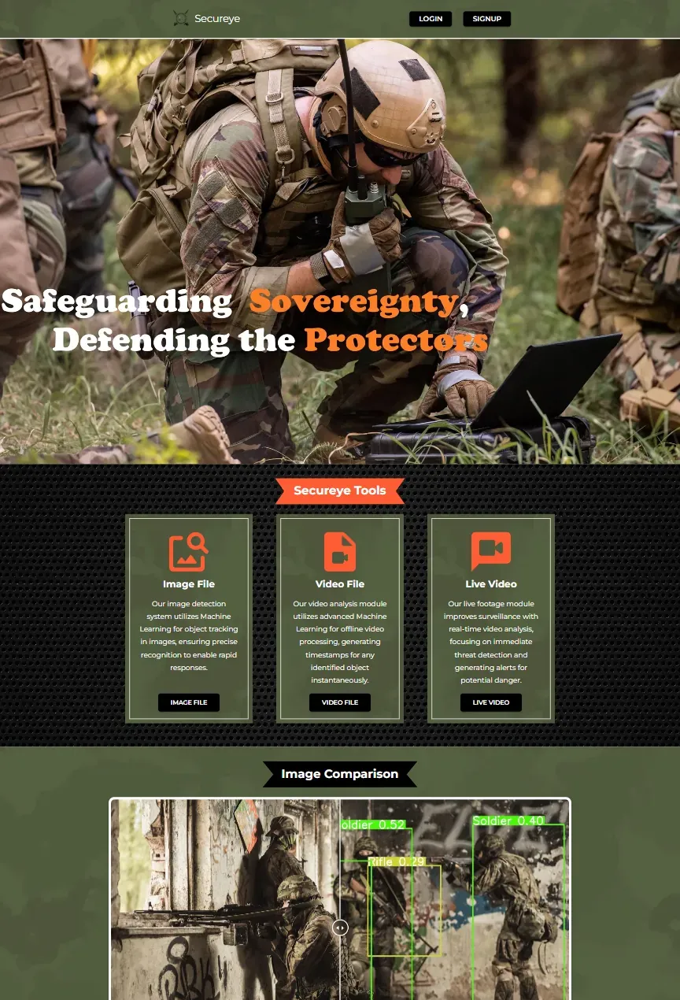
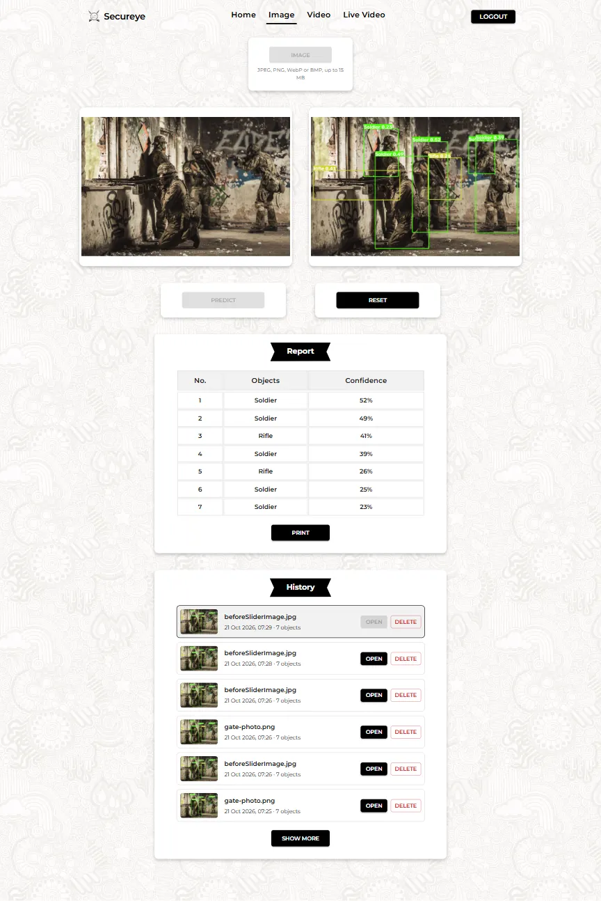
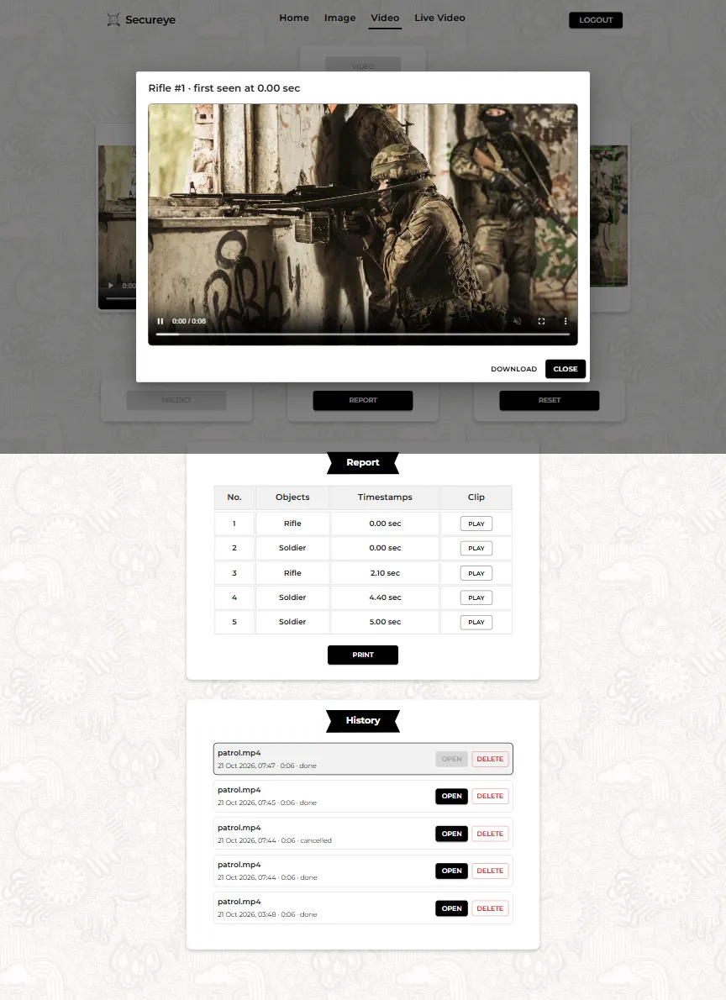
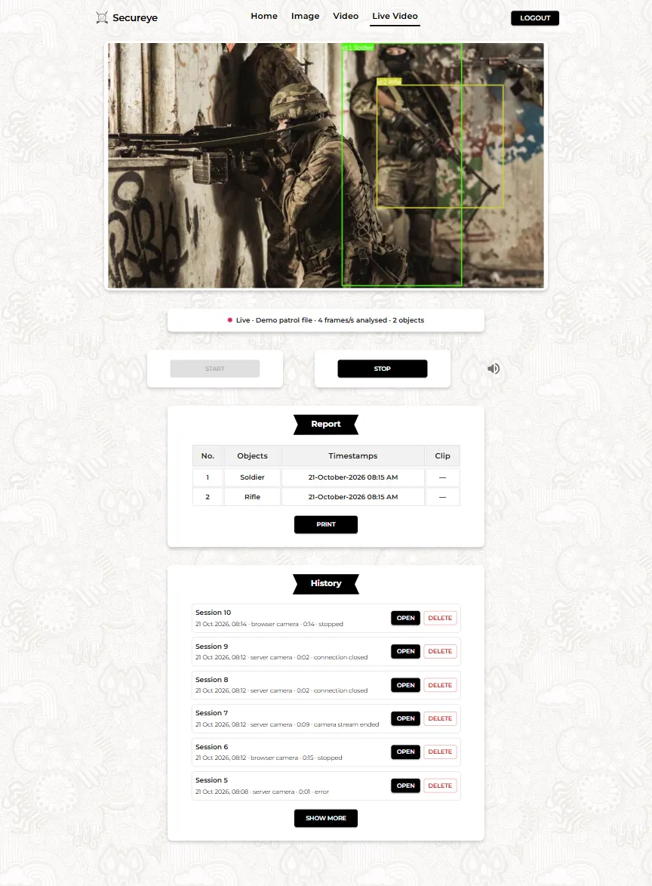
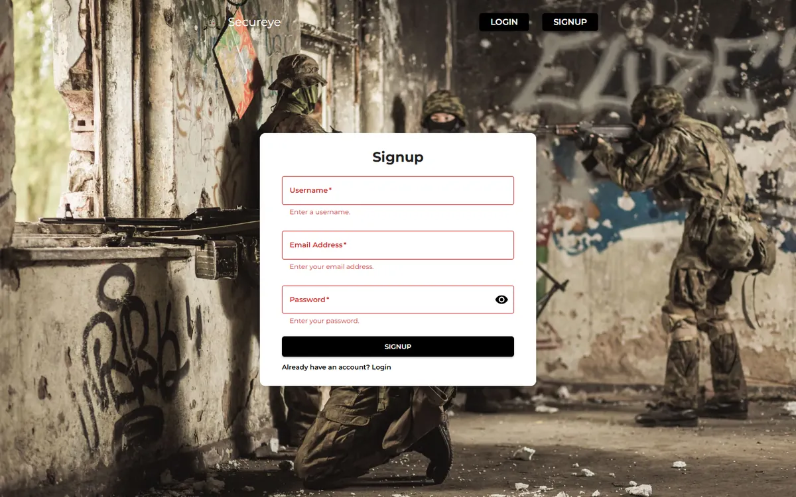
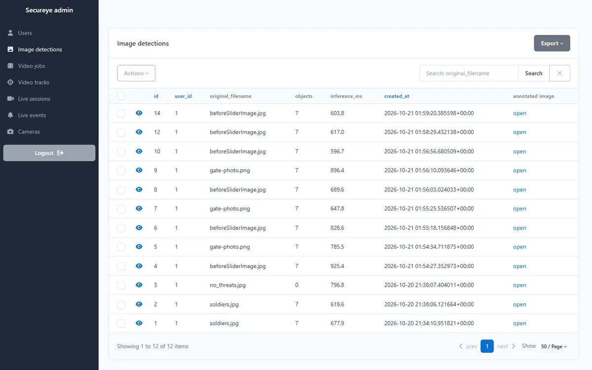
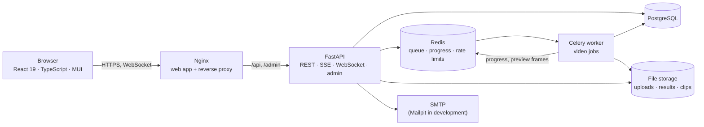

# Secureye


**Threat detection for military security.** Secureye finds soldiers, weapons and military vehicles in  
photos, uploaded videos and live camera feeds, using two YOLOv8 models trained for the project, and  
turns what it sees into reports, clips and alerts.







## Features

| | |
|---|---|
| **Image detection** | Upload a photo; get it back annotated, with a table of objects and confidences, a PDF report and a history of past detections. |
| **Video detection** | Upload a video; it's processed in the background (tracking each object across frames) while annotated frames and progress stream to the page. The report lists each object with the time it first appeared and plays the clip saved for it. |
| **Live detection** | Use your browser's camera (boxes drawn over the video as you watch) or a camera attached to the server. Each new object triggers an alert sound and a report row; sessions are saved with their clips. |
| **Accounts** | Sign up with email activation, log in, reset a forgotten password; sessions survive reloads and are refreshed silently. |
| **Admin** | A superuser-only admin site for users, detections, jobs, sessions and server cameras. |

Classes: Army Vehicle, Handgun, Helicopter, RPG, Rifle, Soldier, Tank. See the [model card](ml-models/README.md) for the models, thresholds and measured speed.

## Architecture



- **Images** are analysed in the request (about 0.6 s on a CPU).
- **Videos** become background jobs: the worker samples 10 frames a second, tracks objects with
ByteTrack and writes an H.264 clip per object. Progress and preview frames reach the page over
Server-Sent Events through Redis.
- **Live detection** runs over one WebSocket per session. The browser sends camera frames, the server
answers with detections, and only the newest frame is analysed, so a slow server never falls behind.

More in [Architecture](docs/architecture.md).

## Tech stack

| | |
|---|---|
| Backend | Python 3.13, FastAPI, SQLAlchemy 2 (async) + Alembic, PostgreSQL, Celery + Redis, structlog, SQLAdmin, uv |
| Detection | Ultralytics YOLOv8 (PyTorch, CPU), ByteTrack, OpenCV, PyAV (H.264) |
| Frontend | React 19, TypeScript (strict), Vite, MUI 9, React Router 8, TanStack Query, Zustand, React Hook Form + Zod, openapi-fetch (types generated from the API) |
| Quality | pytest (244 tests, real-model regression tests), Vitest + Testing Library + MSW (96 tests), Playwright end-to-end tests (8 journeys), Ruff, mypy (strict), ESLint, Prettier, pre-commit |
| Security | Argon2, short-lived JWTs + rotating httpOnly refresh cookies with reuse detection, rate limits, signed file links, CSP and security headers, pip-audit, Bandit, npm audit, Trivy |
| Delivery | Docker (non-root images), Docker Compose, GitHub Actions |

Every dependency and why it's there: [Dependencies](docs/dependencies.md).

## Quick start

Requirements: Docker with Compose, and [Git LFS](https://git-lfs.com/) for the model weights.

```bash
git lfs install
git clone https://github.com/Niraj-Koli/Secureye.git
cd Secureye
cp .env.example .env          # then set SECRET_KEY (the file shows how to generate one)
docker compose --profile app up --build
```

1. Open <http://localhost:8080> and sign up.
2. Activate the account from the email in Mailpit: <http://localhost:8025>.
3. Log in and open **Image**, **Video** or **Live**.

The first build downloads PyTorch, so it takes a few minutes. For the admin site
(<http://localhost:8080/admin>), create a superuser:

```bash
docker compose exec api python -m app.cli create-superuser --email you@example.com --name "Your Name"
```

Cameras need a secure page: browsers allow them on `http://localhost` and on HTTPS. To put Secureye on
a server, put it behind HTTPS and set `PUBLIC_URL` in `.env`.

The [installation guide](docs/installation.md) covers both setups step by step, including the
development setup with hot reload (API, worker and web app on your machine).

## Usage

- **Image:** pick a photo (JPEG, PNG, WebP or BMP, up to 15 MB), click **Predict**, then **Print**
for a PDF report.
- **Video:** pick a video (up to 500 MB and 10 minutes), click **Predict** and watch the progress;
when it's done, **Report** lists every tracked object with a playable clip.
- **Live:** click **Start**, choose your browser's camera or a server camera, and watch the boxes
and the report fill in; **Stop** saves the session.

Each page keeps a history of your past results. The [user guide](docs/usage.md) describes every
page, the admin site and the API, which is documented in the [API reference](docs/api.md).

## Testing

```bash
# from the repository root
docker compose up -d --wait db redis          # services the backend tests need
(cd backend && uv run pytest)                 # backend: 244 tests, incl. the real models
(cd frontend && npm ci && npm test)           # frontend: 96 tests
```

| Check (from the repository root) | Command |
|---|---|
| Backend lint and types | `cd backend && uv run ruff check . && uv run mypy` |
| Frontend lint and types | `cd frontend && npm run lint && npm run typecheck` |
| End-to-end (stack running) | `cd e2e && npm ci && npx playwright install chromium && npx playwright test` |
| Everything on commit | `cd backend && uv run pre-commit install` |

CI ([`.github/workflows/ci.yml`](.github/workflows/ci.yml)) runs all of these, the dependency
and code audits, the end-to-end tests against the Docker images, and an image scan. Details,
including the settings the end-to-end tests need: [Testing](docs/testing.md).

## Documentation

| Guide | Contents |
|---|---|
| [Installation](docs/installation.md) | Prerequisites, Docker setup, development setup, admin account, Git hooks |
| [Configuration](docs/configuration.md) | Every environment variable, its default and its effect |
| [User guide](docs/usage.md) | Accounts, image, video and live detection, the admin site, using the API |
| [API reference](docs/api.md) | Endpoints, errors, rate limits, the progress stream and the WebSocket protocol |
| [Architecture](docs/architecture.md) | Components, folder structure, data model, main flows, security |
| [Testing](docs/testing.md) | Backend, frontend and end-to-end tests, pre-commit, CI |
| [Dependencies](docs/dependencies.md) | Every package and image, and what it's for |
| [Troubleshooting](docs/troubleshooting.md) | Common problems and their fixes |
| [Feature parity](docs/feature-parity.md) | Every feature of the original app, the bugs fixed and the deliberate changes |
| [Model card](ml-models/README.md) | The two models, their classes, thresholds and speed |
| [Backend](backend/README.md), [Frontend](frontend/README.md) | Working on each part alone |
| [Contributing](CONTRIBUTING.md) | Workflow and conventions |

## Project structure

```
backend/            FastAPI app, Celery worker, Alembic migrations, tests
frontend/           React app, Nginx config, tests
e2e/                Playwright end-to-end tests
ml-models/          YOLOv8 weights (Git LFS) and model card
docs/               documentation and screenshots
.github/workflows/  CI
docker-compose.yml  development services; the whole application with --profile app
```

The full tree is in [Architecture](docs/architecture.md#folder-structure).

## Limits and next steps

- **Speed:** detection runs on the CPU, about 7 s per second of 720p video and 3–4 analysed frames a
second in live mode on a typical laptop. A GPU (switch the PyTorch index in
`backend/pyproject.toml`) or an ONNX/OpenVINO export would raise this.
- **Scale:** one API process per container (each holds both models); the live-session limit is
counted per process.
- **Ideas:** retrain on a newer YOLO generation and compare; S3-compatible storage; notifications
(email/webhook) on live alerts; several cameras on one dashboard.

## License

[Apache 2.0](LICENSE) © 2026 Niraj Koli
